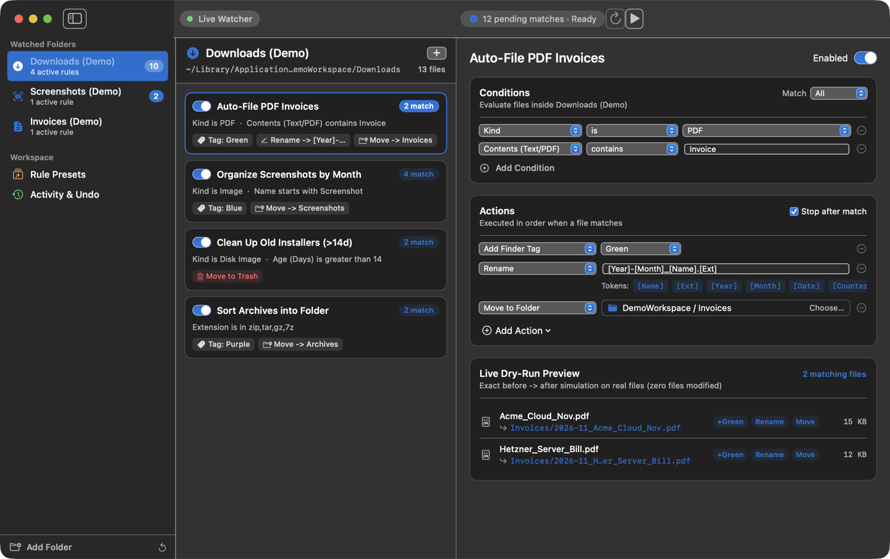

# RuleBox — Open-Source Hazel Alternative for macOS

An independent, free, MIT-licensed **Hazel** alternative for automatic local folder organization on macOS — built natively in **Swift 6, SwiftUI, AppKit, and PDFKit** with zero external dependencies, real-time dry-run `before -> after` previews, and 1-click Undo. *(Inspired by Noodlesoft's [Hazel](https://www.noodlesoft.com/); not affiliated with Noodlesoft.)*

[Latest Release (macOS)](https://github.com/zm57cdj9yb-beep/rulebox/releases/latest) · [Changelog](CHANGELOG.md) · [Example Rules](examples/) · [Benchmarks](benchmarks/RESULTS.md) · [Discussions](https://github.com/zm57cdj9yb-beep/rulebox/discussions) · [MIT License](LICENSE)



## Overview

RuleBox watches your folders locally and automatically renames, tags, sorts, archives, or trashes files based on visual rules — with zero cloud uploads, zero subscriptions, and a 2.9 MB native app bundle.

- **Zero external dependencies:** [`Package.swift`](Package.swift) links only Apple frameworks (`AppKit`, `SwiftUI`, `PDFKit`, `UniformTypeIdentifiers`, `Foundation`).
- **Live Dry-Run Preview:** Every rule edit immediately simulates exact `before -> after` destinations and action badges on your real files without modifying disk.
- **PDF & text content matching:** Inspect embedded PDF text (first 5 pages / 32 KB via `PDFKit`) and plain-text files to auto-file invoices, receipts, and contracts.
- **1-Click Undo journal:** Every move, rename, subfolder sort, ZIP archive, and Finder tag change is recorded in a local transaction log so mistakes reverse in one click.
- **Kernel-level folder watcher & menu bar companion:** Uses `DispatchSourceFileSystemObject` (`O_EVTONLY`) with 400 ms coalescing debounce plus a lightweight `NSStatusItem` menu bar menu.
- **Safe first-launch sandbox:** Starts with a self-contained demo folder (`Downloads (Demo)`, `Screenshots (Demo)`, `Invoices (Demo)`) containing real sample PDFs, PNGs, and DMGs so you can test dry-run, run, and undo before adding your real `~/Downloads`.

## Benchmarks

Measured on an **Apple M2 (8 GB RAM, macOS 27.2)** using a release build (`swift build -c release`). Reproduce locally with [`./benchmarks/run_benchmarks.sh`](benchmarks/run_benchmarks.sh) or inspect full details in [`benchmarks/RESULTS.md`](benchmarks/RESULTS.md).

| Workload | Matched / Ops | Median Time | Throughput / RSS |
|---|---:|---:|---:|
| 1,000-file folder scan + 4-rule dry-run evaluation | 800 matches | **107.2 ms** | ~9,328 files/sec |
| 50 real PDFs scanned via `PDFKit` (`Contents contains "Invoice"`) | 25 matches | **33.7 ms** | 0.67 ms / PDF |
| Execute 100 Finder tags + tokenized renames + subfolder sorts | 100 files | **87.0 ms** | ~1,149 files/sec |
| 1-Click Undo all 100 filesystem operations | 100 undos | **68.4 ms** | ~1,462 undos/sec |
| Peak RSS across full benchmark suite (`/usr/bin/time -l`) | — | — | **54.3 MB** |

## Comparison With Existing Tools

| Capability | RuleBox | Hazel | macOS Folder Actions | Apple Shortcuts |
|---|---|---|---|---|
| License & Price | MIT (Free) | Proprietary ($42) | Built into macOS | Built into macOS |
| Visual Rule Builder | Modern 3-pane SwiftUI | Classic macOS prefs UI (mature) | AppleScript / Automator | Linear block editor |
| Live `Before -> After` Dry-Run | Built-in live preview table | Rule preview popover | None | Manual run only |
| PDF Content Matching | Yes (`PDFKit`) | Yes (plus OCR & custom date tokens) | Via scripts | Limited |
| 1-Click Undo Journal | Yes (move, rename, tag, archive) | Trash / manual | None | None |
| Maturity & Code Signing | Ad-hoc signed v1.0 | **Apple Notarized (18+ years mature)** | Built into macOS | Built into macOS |
| App Size | **2.9 MB** | ~25 MB | Built-in | Built-in |

**When another tool is a better fit:**
- Use **Hazel** if you need an Apple-notarized, battle-tested utility with OCR date-token extraction, Apple Photos/Music integration, and nested rule-matching conditions.
- Use **Apple Shortcuts** if you want cross-device iCloud sync with iOS/iPadOS triggers.

## Example Workspaces

Three ready-to-inspect `.rulebox` JSON files live in [`examples/`](examples/README.md) and are validated automatically by `swift test`:

- [`01-downloads-cleanup.rulebox`](examples/01-downloads-cleanup.rulebox) — Trash `.dmg`/`.pkg` installers older than 14 days and sort archives into `Archives/[Year]` with a Purple tag.
- [`02-pdf-invoice-filer.rulebox`](examples/02-pdf-invoice-filer.rulebox) — Scan PDF text via `PDFKit` for `"Invoice"`, tag Green, prefix `[Year]-[Month]_`, and sort into `Invoices/[Year]`.
- [`03-screenshot-organizer.rulebox`](examples/03-screenshot-organizer.rulebox) — Match macOS PNG screenshots, tag Blue, and group into `Screenshots/[Year]/[Month]`.

## Install & Build

### Pre-Built Release (macOS 14+ Apple Silicon)

1. Download `RuleBox-v1.0.0-macOS-arm64.zip` (and optional `SHA256SUMS.txt`) from [GitHub Releases](https://github.com/zm57cdj9yb-beep/rulebox/releases/latest).
2. Unzip and move `RuleBox.app` to `/Applications`.
3. Because this open-source build is **ad-hoc signed** (not Apple Developer ID notarized), clear Gatekeeper quarantine once:
   ```bash
   xattr -dr com.apple.quarantine "/Applications/RuleBox.app"
   open "/Applications/RuleBox.app"
   ```

### Build From Source (Requires macOS 14.0+ and Xcode / Swift 6)

```bash
git clone https://github.com/zm57cdj9yb-beep/rulebox.git
cd rulebox

swift build
swift test
./scripts/build_app.sh release
codesign --verify --strict --verbose=2 "build/RuleBox.app"
open "build/RuleBox.app"
```

## Architecture Notes

- **Rule Engine (`Sources/RuleBoxCore/Engine/`):** `FileInspector` prefetches `URLResourceValues` metadata in one pass and lazily invokes `PDFKit` only when a rule contains a `Contents (Text/PDF)` condition (capped at 5 pages / 32 KB). `RuleEvaluator` runs pure, side-effect-free dry-run simulations, while `RuleExecutor` performs atomic `FileManager` mutations (`trashItem`, conflict-safe moves/renames, `tagNamesKey`, `/usr/bin/ditto` ZIPs, and 10-second timeout `/bin/zsh` scripts) and records exact `UndoRecord` steps.
- **Watcher (`FolderWatcher.swift`):** Opens each watched directory with `O_EVTONLY` and attaches a `DispatchSourceFileSystemObject` monitoring `.write`, `.extend`, `.rename`, and `.delete` events with a per-folder 400 ms debounce timer.
- **Persistence (`RuleBoxStore.swift`):** Stores rules as plain-text JSON at `~/Library/Application Support/RuleBox/workspace.rulebox` and reversible history at `activity.json`.

## Known Limitations

- **Ad-hoc signing:** Releases require the one-time `xattr -dr com.apple.quarantine` command until Apple Developer ID notarization is added.
- **No OCR on scanned image-only PDFs yet:** `Contents (Text/PDF)` reads embedded PDF text via `PDFKit`; Vision OCR fallback for scanned PDFs is not implemented yet.
- **Watcher mode in v1.0:** Background kernel events automatically refresh live dry-run match counts; automatic unattended execution on file drop (vs. clicking **Run Rules**) is intentionally opt-in in a future release so new users cannot accidentally move files while testing rules.

## Contributing & Security

See [`CONTRIBUTING.md`](CONTRIBUTING.md) for local build/test commands and [`SECURITY.md`](SECURITY.md) for the local shell-script trust model. Participation is governed by [`CODE_OF_CONDUCT.md`](CODE_OF_CONDUCT.md).

## License

Released under the [MIT License](LICENSE).
